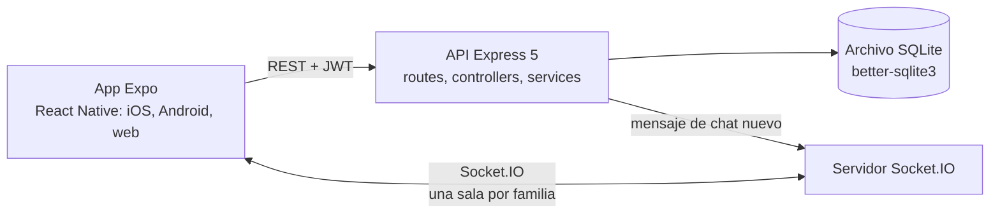

# FamilyQuest

**[English](README.md) · Español**

Gestor de tareas del hogar para familias que convierte las tareas domésticas en un juego compartido: puntos, ranking semanal, chat familiar y una mascota virtual.

[](https://github.com/jmartintechit-blip/FamilyQuest/actions/workflows/ci.yml)
[](LICENSE)

<div align="center">


</div>

Todos los nombres, correos y códigos de invitación de las capturas son ficticios. La interfaz está en español.

**No hay demo alojada.** El backend es un servidor Node con un archivo SQLite y WebSockets, así que se ejecuta en tu propio equipo. Mira el [Inicio rápido](#inicio-rápido).

> FamilyQuest es un proyecto de portfolio que ejecutas tú mismo. No es un servicio alojado y no está endurecido para datos reales de una familia. Mira las [Limitaciones conocidas](#limitaciones-conocidas).

## Por qué existe

Repartir las tareas de casa es una fuente habitual de fricción. FamilyQuest intenta hacerlo más ligero: cada tarea vale puntos, la familia compite en equipo en un ranking semanal y una mascota compartida muestra de un vistazo cómo va el hogar. Está pensada para que la use cualquier miembro de la familia, sea cual sea su edad: botones grandes, lenguaje claro, tema claro/oscuro y tres tamaños de letra.

Fue además el primer proyecto grande del autor. El backend empezó como un solo archivo y más tarde se refactorizó en capas con validación de entrada (mira el [historial de commits](https://github.com/jmartintechit-blip/FamilyQuest/commits/main)).

## Qué hace

Cada familia tiene un espacio privado. Creas una cuenta y entras con un código de invitación.

- **Tareas con puntos.** Un catálogo de 53 tareas predefinidas (39 positivas y 14 negativas), más las tuyas. Con buscador, filtros y una pantalla dedicada para añadir tareas.
- **Ranking semanal.** Los miembros de la familia compiten por puntos y el ranking se reinicia cada semana.
- **Mascota virtual compartida.** Su salud sube con las tareas positivas y baja con las negativas. Hay 6 especies y 6 complementos en 3 categorías (sombreros, gafas, cuello), que se desbloquean con las monedas que gana la familia.
- **Feed de actividad.** Una pestaña de notificaciones muestra quién ha completado qué. Se usan notificaciones locales (mira las limitaciones para las push).
- **Chat familiar en tiempo real** mediante Socket.IO.
- **Gestión de la familia.** Ver miembros y puntos, copiar o compartir el código de invitación, salir de la familia y cambiar tu contraseña.
- **Apariencia.** Tema automático, claro u oscuro; letra normal, grande o muy grande.

## Arquitectura



El backend está organizado en capas y cada recurso (auth, tareas, familias, chat, mascota, notificaciones) sigue el mismo patrón:

- `routes/` declara los endpoints y aplica los middlewares de autenticación y validación.
- `controllers/` lee la petición y arma la respuesta.
- `services/` contiene la lógica de negocio y el SQL. Cuando una acción toca varios dominios (completar una tarea cambia puntos, salud de la mascota y notificaciones), el servicio principal llama a los demás en vez de repetir lógica.
- `schemas/` tiene un esquema de Zod por endpoint, que aplica `middleware/validar.js`.

```text
backend/
├── index.js        Arranque de Express y Socket.IO, monta los routers
├── socket.js       Gestión de conexiones y una sala por familia
├── db/             Conexión SQLite, esquema y migraciones
├── middleware/     Comprobación del JWT, pertenencia a la familia, adaptador de Zod
├── routes/  controllers/  services/  schemas/
frontend/
├── screens/        Una pantalla por archivo
├── components/     UI reutilizable, incluida la mascota en SVG
├── context/        Sesión y tema (React Context)
└── navigation/     Navegación por pestañas
```

Decisiones de diseño que importan:

- **La autorización se comprueba en el servidor.** Conocer un `familia_id` o un `usuario_id` no basta: cada endpoint REST comprueba que el usuario del JWT pertenece a esa familia.
- **Responder primero, notificar después.** La respuesta HTTP se envía antes de generar las notificaciones, así que un efecto secundario lento nunca retrasa al usuario.
- **Reinicio semanal sin cron.** Cada vez que se lee una familia, el servidor comprueba si tocaba reiniciar.
- **La mascota está dibujada con `react-native-svg`**, así que no hay imágenes para ella.
- **`io` se inyecta** (`app.set('io', io)`) en vez de importarse como global, para que los servicios no dependan de cómo arranca el servidor.

## Stack técnico

| Área            | Elección                                                                  |
| --------------- | ------------------------------------------------------------------------- |
| Cliente         | React Native 0.86 con Expo 57 (un solo código para iOS, Android y web)    |
| Navegación      | React Navigation (pestañas y stack)                                       |
| Animación       | React Native Reanimated, react-native-svg                                 |
| Backend         | Node.js 22 o superior, Express 5, por capas                               |
| Validación      | Zod, un esquema por endpoint                                              |
| Base de datos   | SQLite mediante `better-sqlite3`                                          |
| Autenticación   | JWT (7 días) y bcrypt                                                     |
| Tiempo real     | Socket.IO                                                                 |
| Notificaciones  | expo-notifications (sin operación en la build web)                        |
| Calidad         | GitHub Actions                                                            |

## Inicio rápido

Necesitas Node.js 22 o superior (lo exige `better-sqlite3` 13; la CI usa Node 24).

```bash
cd backend && npm ci && cp .env.example .env && node index.js   # API en :3000
```

```bash
cd frontend && npm ci && npx expo start --web                   # segundo terminal
```

Antes del primer arranque, pon en `URL_BASE` de `frontend/constants/config.js` la dirección donde se alcanza la API: `http://localhost:3000` para la build web, o la dirección de red local de tu ordenador si usas Expo Go en el móvil (misma red Wi-Fi). Ahora mismo el archivo contiene la dirección de red local del propio autor, así que la app no conectará hasta que la cambies. Cambia `JWT_SECRET` en `backend/.env` por tu propia cadena larga y aleatoria.

En el móvil, escanea con la app [Expo Go](https://expo.dev/go) el código QR que imprime Expo.

## Tests y calidad

**Todavía no hay una suite de tests automáticos.** `npm test` en el backend sigue siendo el marcador de posición. La hoja de ruta lo lista el primero.

Lo que hace la [CI](.github/workflows/ci.yml) en cada push:

- Backend: `npm ci`, una comprobación de sintaxis de todos los archivos `.js` y un [test de humo](.github/scripts/smoke.mjs) que arranca el servidor real en un directorio temporal y comprueba el registro (201), un correo duplicado (409), una entrada inválida (400), el inicio de sesión con token (200), una contraseña incorrecta (401) y una ruta protegida sin token (401).
- Frontend: `npm ci` y una exportación de producción del bundle web con Expo.
- `npm audit --omit=dev` en ambos, solo como aviso, para que una advisory nueva no bloquee los merges.

Auditoría de dependencias a 2026-10-20: el backend no reporta ninguna advisory. El frontend reporta 34 (11 moderadas, 22 altas y 1 crítica) en el árbol de herramientas de Expo. La crítica es `shell-quote`, una dependencia indirecta de la CLI de Expo. No se han corregido porque `npm audit fix --force` hace cambios incompatibles en la configuración de Expo.

## Seguridad

- Cada endpoint REST que lee o cambia datos de una familia comprueba en el servidor que el usuario autenticado pertenece a esa familia.
- Las contraseñas se guardan con hash bcrypt y la API nunca las devuelve.
- El cuerpo de cada petición se valida con Zod antes de llegar a la lógica de negocio.
- Para reportar una vulnerabilidad, mira [SECURITY.md](SECURITY.md).

Los huecos están listados más abajo, en [Limitaciones conocidas](#limitaciones-conocidas). Léelos antes de usar esto con datos reales.

## Limitaciones conocidas

- **La conexión de Socket.IO no está autenticada.** `unirse_familia` mete al cliente en cualquier sala de familia que nombre, así que un cliente que conozca el id de una familia puede recibir en tiempo real los mensajes de su chat. Los endpoints REST están protegidos; el socket no. Es el hueco más importante.
- **Sin límite de peticiones, sin cabeceras de seguridad** (como `helmet`) y CORS abierto a cualquier origen.
- **`JWT_SECRET` no se comprueba al arrancar.** Sin él el servidor arranca y el inicio de sesión falla después con un error 500.
- **Sin demo alojada ni configuración de despliegue.** SQLite es un archivo local, así que la app está pensada para un solo equipo.
- **El cliente tiene la dirección de la API fija en el código** (`frontend/constants/config.js`), que hoy es la dirección de red local del autor.
- **Las notificaciones push entre miembros de la familia todavía no funcionan.** Requieren vincular el proyecto a EAS. Solo funcionan las notificaciones locales.
- **El token se guarda con `AsyncStorage`**, que no es un almacenamiento cifrado.
- **La interfaz está solo en español**, y los identificadores del código también.
- **Advisories de dependencias del frontend** (mira [Tests y calidad](#tests-y-calidad)).

## Hoja de ruta

Ideas, no promesas:

- [ ] Tests automáticos para los servicios del backend
- [ ] Autenticar la conexión de Socket.IO y comprobar la pertenencia a la familia al unirse
- [ ] Límite de peticiones, cabeceras de seguridad y una política CORS más estricta
- [ ] Rol de administrador familiar (permisos sobre tareas y miembros)
- [ ] Historial de tareas completadas
- [ ] Notificaciones push reales entre miembros (requiere EAS)
- [ ] Build instalable con EAS (`.apk` y `.ipa`)
- [ ] Demo alojada
- [ ] Onboarding para usuarios nuevos
- [ ] Interfaz en inglés

## Desarrollado con asistencia de IA

Este proyecto se desarrolló con asistencia de IA (Claude Code), bajo la dirección del autor. La refactorización del backend en capas, la validación con Zod, el cambio de contraseña, la documentación y la CI se hicieron así. No hay una suite de tests automáticos, así que juzga el código leyéndolo y por el test de humo de la CI.

## Licencia

[MIT](LICENSE)
