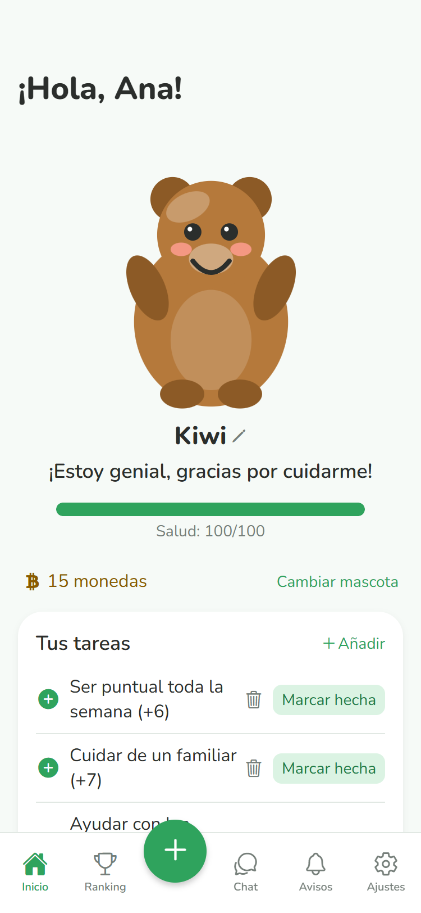
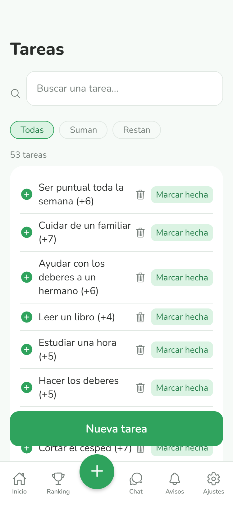
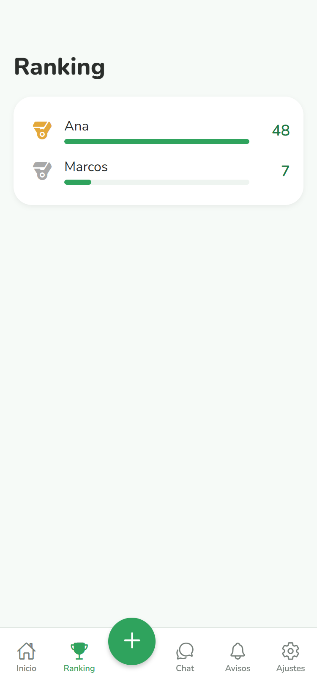
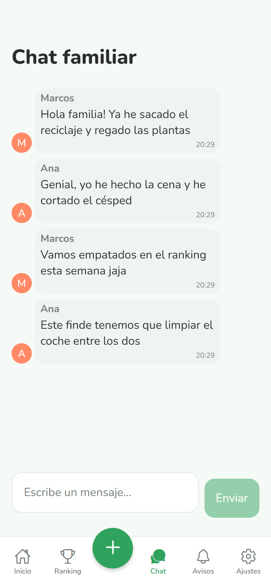
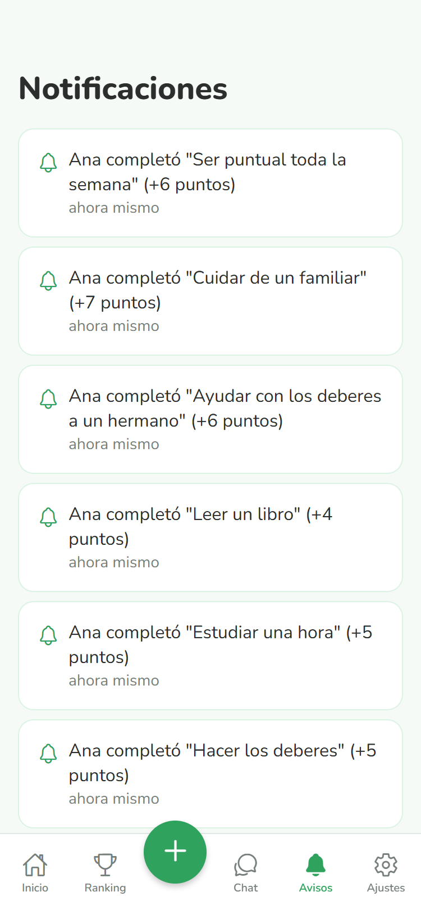
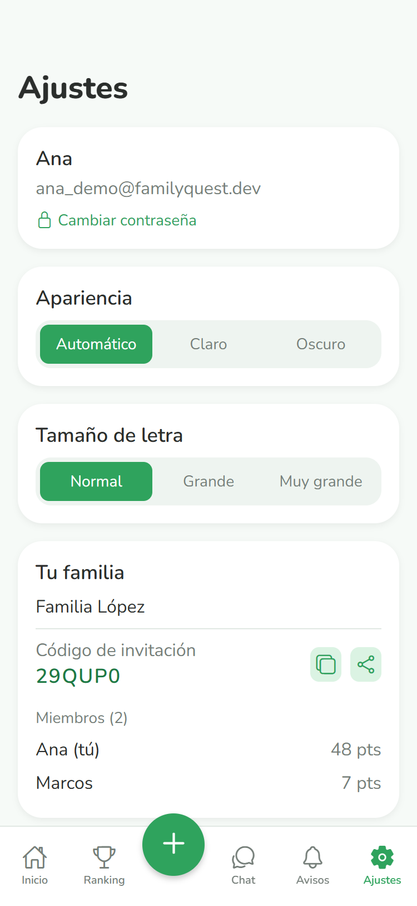
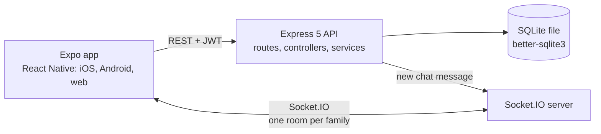

# FamilyQuest

**English · [Español](README.es.md)**

Household task manager for families that turns chores into a shared game: points, a weekly ranking, a family chat and a virtual pet.

[](https://github.com/jmartintechit-blip/FamilyQuest/actions/workflows/ci.yml)
[](LICENSE)

<div align="center">






</div>

All names, e-mails and invite codes in the screenshots are fictitious. The interface is in Spanish.

**There is no hosted demo.** The backend is a Node server with a SQLite file and WebSockets, so it runs on your own machine. See [Quickstart](#quickstart).

> FamilyQuest is a portfolio project that you run yourself. It is not a hosted service and it has not been hardened for real family data. See [Known limitations](#known-limitations).

## Why this exists

Dividing chores at home is a common source of friction. FamilyQuest tries to make it light: every task is worth points, the family competes as a team in a weekly ranking, and a shared pet shows at a glance how the household is doing. It is meant to be usable by any family member whatever their age: big buttons, plain language, a light/dark theme and three font sizes.

It was also the author's first large project. The backend started as a single file and was later refactored into layers with input validation (see the [commit history](https://github.com/jmartintechit-blip/FamilyQuest/commits/main)).

## What it does

Each family gets a private space. You create an account and join with an invite code.

- **Tasks with points.** A catalogue of 53 predefined tasks (39 positive, 14 negative), plus your own. Search, filters, and a dedicated screen to add tasks.
- **Weekly ranking.** Family members compete for points, and the ranking resets every week.
- **Shared virtual pet.** Its health goes up with positive tasks and down with negative ones. There are 6 species and 6 accessories in 3 categories (hats, glasses, neckwear), unlocked with coins the family earns.
- **Activity feed.** A notifications tab shows who completed what. Local notifications are used (see limitations for push).
- **Family chat in real time** over Socket.IO.
- **Family management.** See members and points, copy or share the invite code, leave the family, change your password.
- **Appearance.** Automatic, light or dark theme; normal, large or very large font.

## Architecture



The backend is organised in layers and every resource (auth, tareas, familias, chat, mascota, notificaciones) follows the same pattern:

- `routes/` declares the endpoints and applies the auth and validation middleware.
- `controllers/` reads the request and shapes the response.
- `services/` holds the business logic and the SQL. When one action touches several domains (completing a task changes points, pet health and notifications), the main service calls the others instead of repeating logic.
- `schemas/` has one Zod schema per endpoint, applied by `middleware/validar.js`.

```text
backend/
├── index.js        Express and Socket.IO bootstrap, mounts the routers
├── socket.js       Connection handling and one room per family
├── db/             SQLite connection, schema and migrations
├── middleware/     JWT check, family membership, Zod adapter
├── routes/  controllers/  services/  schemas/
frontend/
├── screens/        One screen per file
├── components/     Reusable UI, including the SVG pet
├── context/        Session and theme (React Context)
└── navigation/     Tab navigation
```

Design decisions that matter:

- **Authorization is checked on the server.** Knowing a `familia_id` or `usuario_id` is not enough: each REST endpoint checks that the user in the JWT belongs to that family, and the Socket.IO connection needs a valid JWT and only lets you join your own family's room.
- **Respond first, notify after.** The HTTP response is sent before notifications are produced, so a slow side effect never delays the user.
- **Weekly reset without a cron job.** Each time a family is read, the server checks whether a reset was due.
- **The pet is drawn with `react-native-svg`**, so there are no image assets for it.
- **`io` is injected** (`app.set('io', io)`) instead of imported as a global, so services do not depend on how the server starts.

## Tech stack

| Area          | Choice                                                              |
| ------------- | ------------------------------------------------------------------- |
| Client        | React Native 0.86 with Expo 57 (one codebase for iOS, Android, web) |
| Navigation    | React Navigation (tabs and stack)                                   |
| Animation     | React Native Reanimated, react-native-svg                           |
| Backend       | Node.js 22 or newer, Express 5, layered                             |
| Validation    | Zod, one schema per endpoint                                        |
| Database      | SQLite through `better-sqlite3`                                     |
| Auth          | JWT (7 days) and bcrypt                                             |
| Real time     | Socket.IO                                                           |
| Notifications | expo-notifications (a no-op on the web build)                       |
| Tests and CI  | Node's built-in test runner, `socket.io-client`, GitHub Actions    |

## Quickstart

You need Node.js 22 or newer (`better-sqlite3` 13 requires it; CI uses Node 24).

```bash
cd backend && npm ci && cp .env.example .env && node index.js   # API on :3000
```

```bash
cd frontend && npm ci && npx expo start --web                   # second terminal
```

The app finds the API on its own: it uses the address of the computer running Expo (the one your phone already reaches) with port 3000, or `localhost` on the web build. To point it somewhere else, set `EXPO_PUBLIC_API_URL`. Change `JWT_SECRET` in `backend/.env` to your own long random string.

On a phone, scan the QR code that Expo prints with the [Expo Go](https://expo.dev/go) app (same Wi-Fi as your computer).

## Tests and quality

```bash
cd backend && npm test
```

17 tests pass on this commit, using Node's built-in test runner. Each test file starts the real server in a temporary directory (so it never touches your database) and talks to it over HTTP and Socket.IO:

- [`auth.test.js`](backend/test/auth.test.js) (7): sign-up, duplicate e-mail, validation errors, login, wrong password, protected routes with a missing or fake token, and the password change.
- [`familias.test.js`](backend/test/familias.test.js) (7): the 53-task catalogue, joining with an invite code, points and the ranking, task validation, chat without impersonation, and an isolation test that makes a user from another family call 17 endpoints of this family and expects 403 on all of them.
- [`socket.test.js`](backend/test/socket.test.js) (3): no connection without a valid token, a member receives their family's messages, and a member of another family can neither join the room nor receive them.

The frontend has no tests.

What [CI](.github/workflows/ci.yml) does on every push:

- Backend: `npm ci`, a syntax check of every `.js` file and `npm test`.
- Frontend: `npm ci` and a production export of the web bundle with Expo.
- `npm audit --omit=dev` for both, as a warning only, so a new advisory does not block merges.

Dependency audit on 2026-10-20: the backend reports 0 advisories. The frontend reports 26 (8 moderate, 18 high, none critical), all in the Expo and React Native build tooling (Metro, the Expo CLI and similar). There is no compatible fix: the one `npm audit` suggests would downgrade Expo to SDK 44.

## Security

- Every REST endpoint that reads or changes family data checks on the server that the authenticated user belongs to that family.
- Passwords are hashed with bcrypt and never returned by the API.
- Every request body is validated with Zod before it reaches the business logic.
- To report a vulnerability, see [SECURITY.md](SECURITY.md).

The gaps are listed below, in [Known limitations](#known-limitations). Read them before using this with real data.

## Known limitations

- **No rate limiting, no security headers** (such as `helmet`), and CORS is open to every origin. Requests are authenticated with a bearer token, not a cookie, but tighten this before deploying.
- **`JWT_SECRET` is not checked at start-up.** Without it the server starts, and login then fails with a 500 error.
- **No hosted demo and no deployment setup.** SQLite is one local file, so the app is meant for one machine.
- **Push notifications between family members do not work yet.** They need the project to be linked to EAS. Only local notifications work.
- **The token is stored with `AsyncStorage`**, which is not encrypted storage.
- **The interface is in Spanish only**, and the code identifiers are in Spanish too.
- **Frontend dependency advisories** in the build tooling (see [Tests and quality](#tests-and-quality)).
- **The frontend has no tests**, and the tests do not cover pet cosmetics, notifications or the weekly reset.

## Roadmap

Ideas, not promises:

- [ ] Rate limiting, security headers and a stricter CORS policy
- [ ] Fail fast when `JWT_SECRET` is missing
- [ ] Tests for the pet, notifications and the weekly reset
- [ ] Family admin role (permissions over tasks and members)
- [ ] History of completed tasks
- [ ] Real push notifications between members (needs EAS)
- [ ] Installable build with EAS (`.apk` and `.ipa`)
- [ ] Hosted demo
- [ ] Onboarding for new users
- [ ] English interface

## Built with AI assistance

This project was developed with AI assistance (Claude Code), under the author's direction. The backend refactor into layers, the Zod validation, the password change, the Socket.IO authentication, the tests, the documentation and the CI were done that way. The tests are the best way to judge the backend; the frontend has none.

## License

[MIT](LICENSE)
